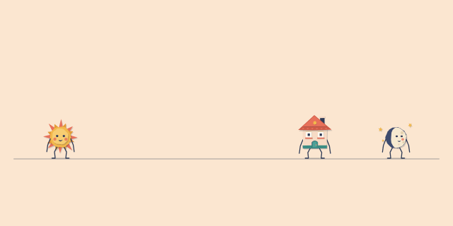
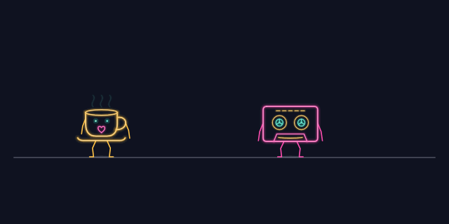
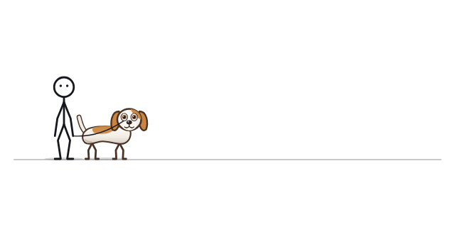
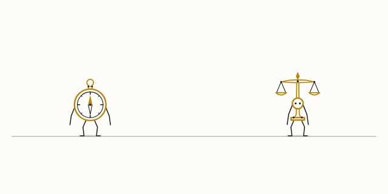
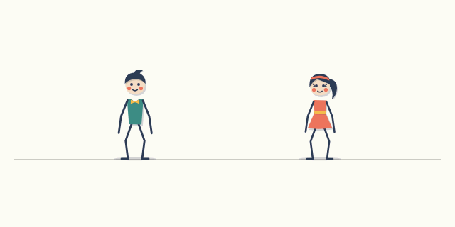
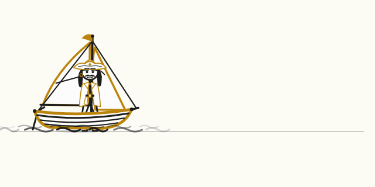
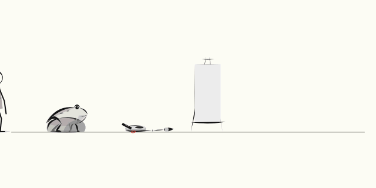
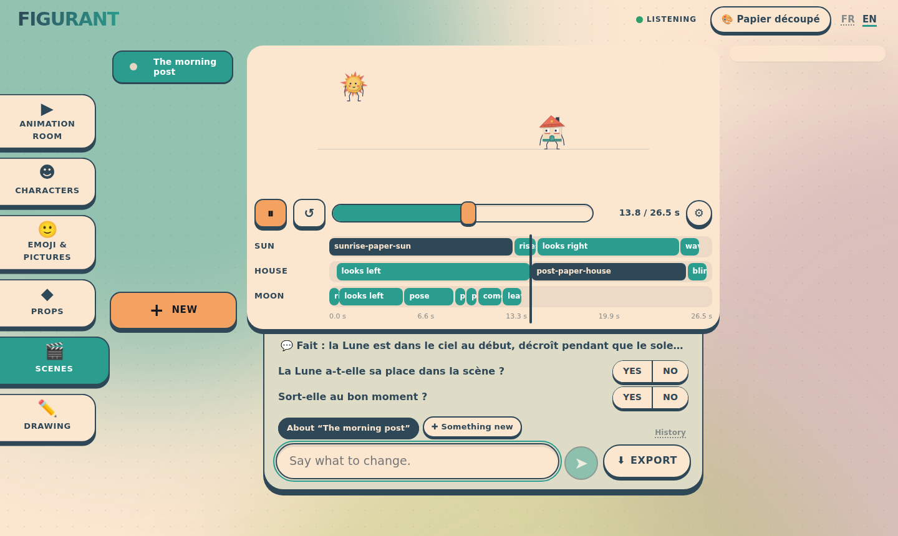
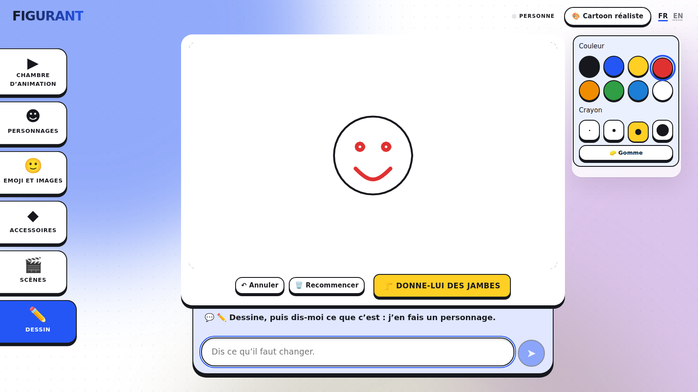

# Figurant

**Donnez des bras et des jambes à n'importe quoi, et faites-le bouger en disant ce que vous voulez.**

Figurant est un petit studio d'animation qui tourne sur votre machine.
Dessinez quelque chose (ou choisissez un personnage), dites ce qu'il doit
faire, et un assistant de code écrit l'animation pendant que vous regardez.
Ce que vous fabriquez s'exporte en GIF, ou en dossier prêt à poser dans un
site web.



| | |
|---|---|
|  |  |
|  |  |
|  |  |
|  |  |
|  | |

- **Aucune dépendance, rien à installer.** Des modules JavaScript et du SVG.
  Il suffit de Node 20.6 ou plus récent.
- **Fait pour être conduit par un assistant** (Claude Code, Codex, un modèle
  local…), que la personne devant l'écran sache coder ou non.
- **Tout est local.** Rien ne quitte votre machine ; il n'y a pas de compte.
- **Licence MIT.**

Read in English: [README.md](README.md)

## L'essayer en une minute

```
git clone https://github.com/H2-CO3/figurant.git
cd figurant
node cli/figurant.js atelier
```

Ouvrez l'adresse affichée (`http://localhost:4173/__figurant/` ; si ce port
est pris, ajoutez `--port 5000`). Vous êtes
dans l'atelier, avec toute la bibliothèque : 38 personnages, 72 animations et
16 scènes, dans six styles de dessin.

Sans assistant, vous pouvez déjà tout regarder, ralentir, avancer image par
image, dessiner sur le tableau blanc et donner des jambes à votre dessin, et
exporter un GIF.

Pour faire **fabriquer** des choses, ouvrez votre assistant de code dans le
même dossier et dites-lui :

> Lis AGENTS.md et docs/ATELIER.md. Lance ensuite
> `node cli/figurant.js fiches --wait` en tâche de fond et réponds à ce que
> j'écris dans l'atelier.

À partir de là vous n'utilisez plus que la page : écrivez dans la zone du
bas, l'assistant dessine ou anime, la page montre le résultat et vous
demande si c'est bon.



## Ce qu'il y a dans l'atelier

- **Six gros boutons** à gauche : animations, personnages, emoji et images,
  accessoires, scènes (plusieurs personnages, chacun sur sa piste dans le
  temps) et le tableau blanc.
- **Une seule zone pour parler.** Dites ce que vous voulez, ou ce qui ne va
  pas ; répondez d'un clic aux questions oui/non de l'assistant.
- **Une timeline** que l'on fait glisser, pour regarder n'importe quel
  moment d'une scène.
- **Les versions.** Chaque changement est un enregistrement git ; la page les
  liste, rejoue n'importe laquelle et peut en reprendre une. Deux miniatures
  montrent l'*avant* et l'*après*.
- **Les styles.** Un style est une consigne en mots simples pour qui
  dessine, et quatre couleurs pour la page. Six sont fournis ; écrivez le
  vôtre.
- **L'export.** Un bouton : un GIF, et un dossier avec les fichiers, le
  moteur, une page de démonstration et un manuel pour qui l'intègre.

### Le tableau blanc



Dessinez à la souris, au doigt ou au stylet (la pression épaissit le trait).
Ensuite, soit vous appuyez sur **Donne-lui des jambes** et votre dessin
tient aussitôt debout (faites-le alors marcher, sauter ou saluer), soit vous dites ce que c'est et l'assistant en fait un vrai
personnage dans le style en cours, en gardant vos traits.

## Votre propre projet

Le dépôt est lui-même un projet, avec la bibliothèque. Pour en commencer un
vide à côté :

```
node cli/figurant.js init ../mes-animations
node cli/figurant.js atelier ../mes-animations
```

Il contient un bonhomme bâton, une figure qui porte un emoji ou une image en
guise de tête, une animation, un style à réécrire et un dépôt git (les
versions viennent de son historique).

Pour emporter un élément de la bibliothèque dans un site web, voir
[docs/INTEGRATION.md](docs/INTEGRATION.md) (en anglais) : `figurant take`
copie les fichiers choisis et le moteur en simples modules, sans étape de
compilation.

## À lire avant d'ouvrir le projet de quelqu'un d'autre

Un personnage ou une animation, c'est **du code** : il s'exécute dans la
page, et `figurant.config.js` s'exécute dans Node au lancement d'une
commande. N'ouvrez que des projets et des bibliothèques en qui vous avez
confiance, comme pour n'importe quel programme. Le serveur de l'atelier
n'écoute que sur cette machine (sauf lancé avec `--lan`, qui ouvre votre
réseau local avec un code d'accès), ne répond qu'à `localhost`, ne sert jamais
les fichiers cachés et n'écrit nulle part ailleurs que dans le projet.

## En faire autre chose

Figurant arrive avec une direction (des pattes pour les dessins, animés en
parlant), et c'est un bac à sable : pas de compilation, pas de dépendance,
des fichiers lisibles que vous et votre assistant pouvez modifier, sous
licence MIT. Demandez un autre genre d'animation, une autre interface, un
jeu, un outil à vous. Le bouton **Changer l'interface** de l'atelier est là
pour ça : dites ce que la page elle-même doit devenir.
[AGENTS.md](AGENTS.md) dit à l'assistant qu'il en a le droit.

## Où il en est

Il fonctionne, et il est jeune. Limites connues :

- Il faut un assistant pour fabriquer du nouveau ; sans lui l'atelier
  montre, dessine et exporte, mais rien ne répond à ce que vous écrivez.
- La timeline montre et positionne ; elle ne déplace pas encore les clips.
- Les noms des personnages et des animations s'affichent en anglais.
- Pas encore sur npm : utilisez le clone.

La suite est dans [docs/ROADMAP.md](docs/ROADMAP.md).

## Guides (en anglais)

- [AGENTS.md](AGENTS.md) : pour l'assistant, par où commencer.
- [docs/ATELIER.md](docs/ATELIER.md) : l'atelier et sa conversation par fichiers.
- [docs/CHARACTERS.md](docs/CHARACTERS.md), [docs/SCENES.md](docs/SCENES.md) : comment s'écrivent un personnage et une animation.
- [docs/DESIGN.md](docs/DESIGN.md) : ce qui rend un personnage digne d'être regardé.
- [docs/INTEGRATION.md](docs/INTEGRATION.md) : les mettre sur un site web.

## Développement

```
npm test
```

Il n'y a rien à installer. Un bug reçoit d'abord un test qui échoue.

## Qui l'a fait

Figurant est de H2CO3, écrit avec Claude (Anthropic) dans Claude Code : la
direction, le regard et chaque décision sont ceux d'une personne ; l'essentiel
du code et des tests a été écrit par l'assistant, nommé co-auteur sur les
enregistrements.
