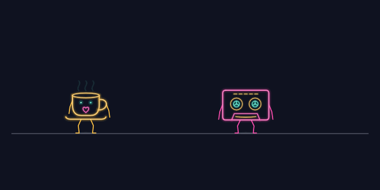
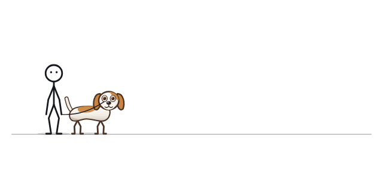
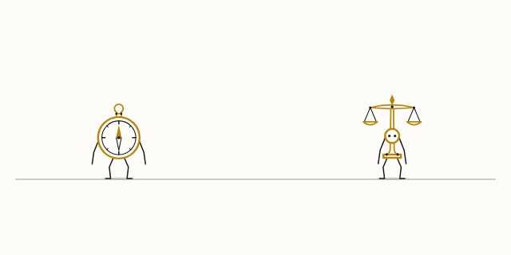
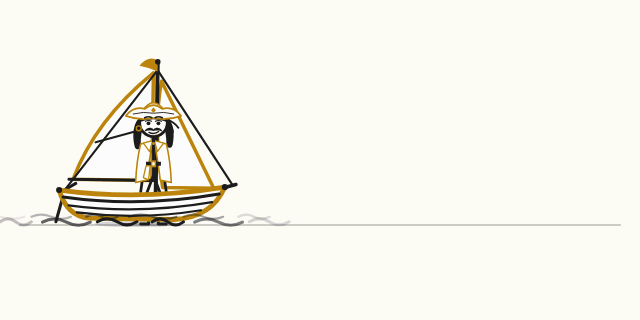
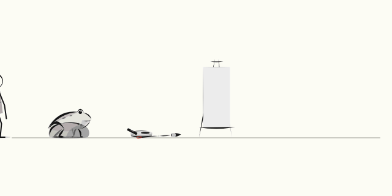
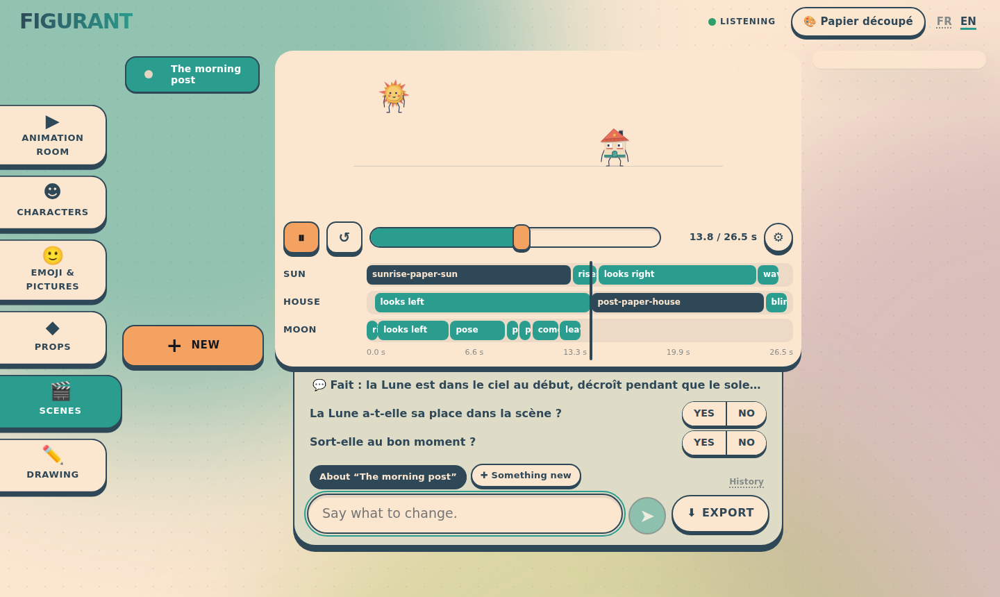
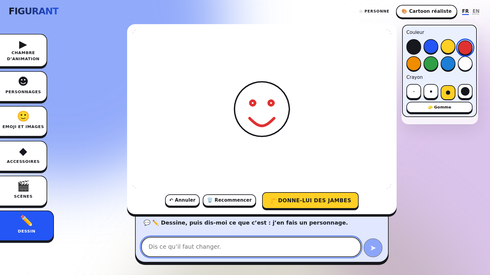

# Figurant

**Give arms and legs to anything, and make it move by saying what you want.**

Figurant is a small animation studio that runs on your machine. Draw
something (or pick a character), say what it should do, and a coding
assistant writes the animation while you watch. What you make exports as a
GIF, or as a folder ready to drop into a website.


| | |
|---|---|
|  |  |
|  |  |
|  |  |
|  |  |
|  | |

- **No dependency, nothing to install.** Plain JavaScript modules and SVG.
  Node 20.6 or later is all it needs.
- **Made to be driven by an assistant** (Claude Code, Codex, a local
  model…), whether the person in front of it writes code or not.
- **Runs locally.** Nothing leaves your machine; there is no account.
- **MIT licensed.**

Lire en français : [README.fr.md](README.fr.md)

## The shortest way: one sentence to your assistant

If you have a coding assistant (Claude Code, Codex…), you do not need to
install or read anything. Open it in an empty folder and paste:

> Clone https://github.com/H2-CO3/figurant, read its AGENTS.md, start the
> atelier and give me the address. Then answer what I write in the page.

It clones, starts the page, tells you where to open it and listens. You talk
in the page; it draws and animates.

## Try it in a minute, by hand

```
git clone https://github.com/H2-CO3/figurant.git
cd figurant
node cli/figurant.js atelier
```

Open the address it prints (`http://localhost:4173/__figurant/`; if that port
is taken, add `--port 4200`). You are in
the atelier, with the whole library: 38 characters, 72 animations and 16
scenes, in six drawing styles.

Without an assistant you can already watch everything, slow it down, step
through it frame by frame, draw on the whiteboard and give your drawing legs,
and export a GIF.

To have things **made** for you, open your coding assistant in the same
folder and tell it:

> Read AGENTS.md and docs/ATELIER.md. Then run
> `node cli/figurant.js fiches --wait` in the background and answer what I
> write in the atelier.

From then on you only use the page: write in the box at the bottom, the
assistant draws or animates, the page shows the result and asks you whether
it is right.



## What is in the atelier

- **Six big buttons** on the left: animations, characters, emoji and
  pictures, props, scenes (several characters, each on its track in time),
  and the whiteboard.
- **One box to talk in.** Say what you want, or what is wrong; answer the
  assistant's yes/no questions with a click.
- **A timeline** you can drag, to look at any moment of a scene.
- **Versions.** Every change is a commit; the page lists them, plays any of
  them, and can take one back. Two thumbnails show *before* and *after*.
- **Styles.** A style is a brief in plain words for whoever draws, and four
  colours for the page. Six come with the library; write your own.
- **Export.** One button: a GIF, and a folder with the files, the engine, a
  demo page and a manual for whoever puts it on a site.

### The whiteboard



Draw with a mouse, a finger or a stylus (pressure widens the line). Then
either press **Give it legs**, and your drawing stands on them at once (then
make it walk, jump or wave), or say what
it is, and the assistant makes a full character of it in the style in use,
keeping your lines.

## Your own project

The repository is itself a project, with the library. To start an empty one
next to it:

```
node cli/figurant.js init ../my-animations
node cli/figurant.js atelier ../my-animations
```

It comes with a stick figure, a figure that wears an emoji or a picture for a
head, one animation, a style to rewrite, and a git repository (the versions
come from its history).

To bring something from the library into a website, see
[docs/INTEGRATION.md](docs/INTEGRATION.md): `figurant take` copies the chosen
files and the engine as plain modules, with no build step.

## Read this before running someone else's project

A character or an animation is **code**: it runs in the page, and
`figurant.config.js` runs in Node when a command starts. Open only projects
and libraries you trust, as you would any program. The atelier's server
listens on this machine only (unless you start it with `--lan`, which lets
your local network in with an access code), answers to `localhost` only, never serves
hidden files, and writes nowhere but inside the project.

## Make it something else

Figurant comes with a direction (legs for drawings, animated by talking), and
it is a sandbox: no build step, no dependency, plain files you and your
assistant can read and change, under the MIT licence. Ask for another kind of
animation, another interface, a game, a tool of your own. The button **Change
the interface** in the atelier is there for that: say what you want the page
itself to become. [AGENTS.md](AGENTS.md) tells the assistant it may.

The same goes for where the material comes from. Nothing of the kind is built
in, and nothing is in the way: ask your assistant to plug your copy into what
you already have, an MCP server, an image model running on your machine, a
folder of drawings, and to turn what comes out into characters and props.

## Where it stands

It works, and it is young. Known limits:

- An assistant is needed to make anything new; without one the atelier shows,
  draws and exports, but nothing answers what you write.
- The timeline shows and seeks; it does not yet move clips.
- Names of characters and animations are shown in English.
- Not on npm yet: use the clone.

What comes next is in [docs/ROADMAP.md](docs/ROADMAP.md).

## Guides

- [AGENTS.md](AGENTS.md): for the assistant, where to start.
- [docs/ATELIER.md](docs/ATELIER.md): the atelier and its conversation by files.
- [docs/CHARACTERS.md](docs/CHARACTERS.md), [docs/SCENES.md](docs/SCENES.md): how a character and an animation are written.
- [docs/DESIGN.md](docs/DESIGN.md): what makes a character worth looking at.
- [docs/INTEGRATION.md](docs/INTEGRATION.md): putting them on a website.

## Development

```
npm test
```

There is nothing to install. A bug gets a test that fails first.

## Who made it

Figurant is by H2CO3, written together with Claude (Anthropic) in Claude Code:
the direction, the eye and every decision are a person's; most of the code and
the tests were written by the assistant, which is named as co-author on the
commits.
